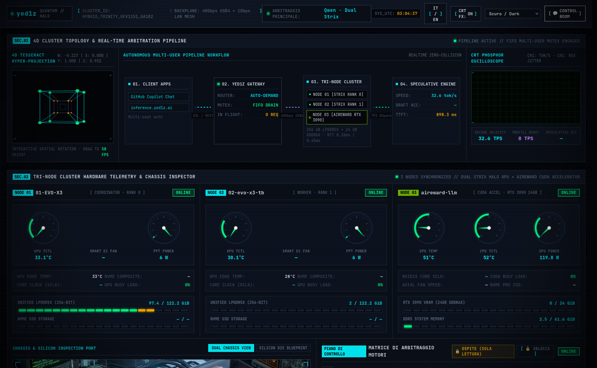
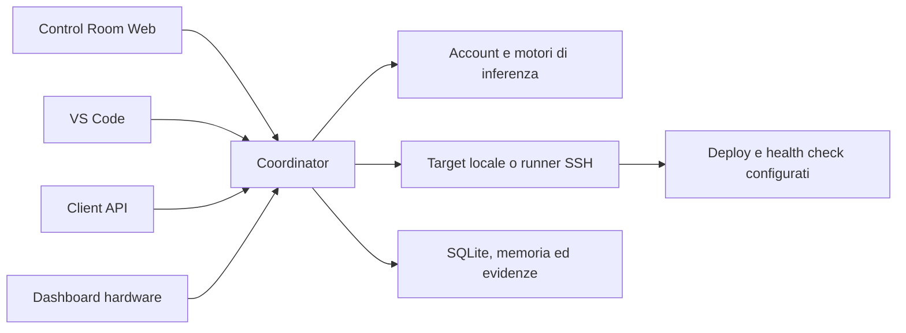

# yed1z · Control Room

**Un progetto, più modelli, una traccia verificabile del lavoro.** Con yed1z puoi far pianificare una modifica a un modello remoto, affidare il codice a una GPU del tuo cluster e chiedere la revisione a un altro account. Dal browser o da VS Code ritrovi la stessa conversazione, i file forniti agli agenti, i test eseguiti e il commit candidato. La dashboard hardware mostra nel frattempo cosa sta facendo la macchina che paga il costo dell’inferenza.

**Versione 1.0.0-rc.1** · [Dashboard hardware dal vivo](https://yed1z.ai/) · [Apri la Control Room](https://yed1z.ai/control) · [Indice della documentazione](docs/README.md)



## Scegli da dove entrare

| Ingresso | Cosa trovi | Quando usarlo |
|---|---|---|
| [Dashboard hardware · /](https://yed1z.ai/) | HUD Strix originale, topologia, strumenti dei nodi, attività e misure del gateway. Il pulsante **Control Room** apre l’applicazione. | Per vedere quale motore è acceso, leggere i sensori o tenere il cluster su un monitor dedicato. |
| [Control Room · /control](https://yed1z.ai/control) | Progetti, conversazioni, agenti, modelli e account, conoscenza, consumi e consegne. | Per lavorare su un progetto, decidere dove eseguirlo e verificare il risultato. |
| [Fleet monitor · /cockpit](https://yed1z.ai/cockpit) | Stato sintetico di nodi, engine e risorse condivise. | Per controllare la disponibilità della flotta. Il vecchio indirizzo [Cockpit Classic](https://yed1z.ai/cockpit/classic) apre la dashboard hardware completa. |
| [Estensione VS Code](vscode/README.md) | La Control Room nell’editor con accesso nativo e invio della selezione al contesto. | Per passare da un file alla conversazione e riaprire nel browser la stessa missione. |
| [API del gateway](docs/RIFERIMENTO-FUNZIONI.md) | Catalogo per utente, Chat Completions, Responses, streaming e controllo dei progetti. | Per usare il cluster da un client compatibile o integrare il coordinator nel proprio software. |

## Indice del prodotto

- [Una missione con tre fonti di inferenza](#una-missione-con-tre-fonti-di-inferenza)
- [Cosa mostra la dashboard hardware](#cosa-mostra-la-dashboard-hardware)
- [Account, quote e scelta del motore](#account-quote-e-scelta-del-motore)
- [Dalla conversazione alla consegna](#dalla-conversazione-alla-consegna)
- [Conoscenza e contesto](#conoscenza-e-contesto)
- [Prestazioni misurate](#prestazioni-misurate)
- [Installazione e primo progetto](#installazione-e-primo-progetto)
- [Collegare hardware e client](#collegare-hardware-e-client)
- [Esercizio, dati e licenza](#esercizio-dati-e-licenza)

## Una missione con tre fonti di inferenza

Nel collaudo del 18 novembre 2026 abbiamo chiesto al sistema di correggere la gestione dei fine riga in un piccolo progetto JavaScript e di preservare le righe vuote. Lo stesso obiettivo, il file allegato e il criterio di verifica sono rimasti disponibili lungo tutta la missione.

| Passaggio | Chi lo ha eseguito | Cosa ha lasciato nel progetto |
|---|---|---|
| Pianificazione | Astra via GemRouter | Piano, assegnazioni e dipendenze fra i task |
| Modifica | Qwen su Strix | Modifica di `index.js` nel worktree dedicato |
| Revisione | Codex con account autenticato | Lettura del file effettivo con `yed1z_read_file`, contenuto letto e digest SHA-256 |
| Verifica | Runner del target | Esecuzioni riuscite di `npm test` e `npm run build`, report e commit candidato |

Aprendo **Percorso del progetto** puoi selezionare il revisore nel grafo, leggere il file su cui ha basato il giudizio e passare al risultato del verificatore. Gli otto eventi di inferenza della missione corrispondono a due chiamate GemRouter, cinque Qwen e un turno nativo Codex. Un’altra missione ha verificato anche la promozione del candidato su un ramo Git dedicato. [Esiti, contatori e prove del collaudo](docs/CONSEGNA-1.0-RC1.md#missione-finale-con-tre-fonti)

## Cosa mostra la dashboard hardware

La home è il cockpit del Gateway originale. Puoi osservare i due Strix, il nodo CUDA e il percorso della richiesta, ruotare la topologia, leggere i pannelli hardware e passare dalla vista cluster al progetto senza cambiare dominio.

| Lettura | Come interpretarla |
|---|---|
| Nodi e sensori | Carico, memoria, temperatura e potenza dipendono dai sensori esposti dal nodo. L’interfaccia distingue un valore osservato pari a zero da una misura assente. |
| Motore attivo e richieste in corso | Aiutano a capire se l’attesa deriva da una risorsa occupata o dall’avvio del motore. La topologia configurata descrive le connessioni note all’operatore. |
| Primo token, prefill e decode | Descrivono fasi diverse della generazione. I valori dipendono da motore, modello, contesto e dettagli restituiti dall’upstream. |
| Statistiche del gateway | Le richieste alla facciata API hanno contatori propri. Per le chiamate degli agenti e l’uso per account apri **Consumi** nella Control Room. |
| Accesso e preferenze | L’HUD supporta italiano e inglese. Tema ed effetti seguono la scelta dell’utente. La modalità ospite usa la proiezione pubblica quando abilitata. Lo switch manuale del motore richiede autorizzazione. |

[Guida alla dashboard e ai suoi comandi](docs/GUIDA-PRODOTTO.md#hud)

## Account, quote e scelta del motore

In **Modelli e account** colleghi un provider, scegli il profilo e interroghi il suo catalogo. La rotta identifica il modello offerto da **quell’account**. Due account possono esporre lo stesso nome di modello e avere quote, autorizzazioni e disponibilità differenti. Il modello può cambiare fra un turno e il successivo mantenendo storia e allegati nel progetto.

| Fonte | Collegamento | Evidenza sul cluster di riferimento |
|---|---|---|
| Codex | Login ufficiale, profilo privato per account, catalogo e finestre di quota del runtime. | Un account autenticato ha restituito quattro modelli e ha completato chat e revisione della missione. La seconda identità reale richiede ancora il login del titolare. |
| Antigravity | Login Google dalla Control Room tramite CLI ufficiale e scoperta via ACP. Ogni nuovo account ha il proprio profilo. | Avvio reale del consenso e annullamento verificati. Catalogo dopo il consenso su due profili esercitato con CLI di prova. La generazione con identità Google reali attende il consenso dei titolari. |
| GemRouter | Base compatibile OpenAI e credenziale del profilo. La scoperta alimenta il selettore. | Il catalogo ha restituito Astra, Gemini e Gemma. Astra ha pianificato una missione. Gemini e Gemma hanno segnalato alta domanda o timeout durante il collaudo. |
| Motori locali e remoti | Endpoint compatibile OpenAI oppure Ollama, diretto o tramite bridge installato sul nodo. | Qwen e DeepSeek hanno generato su Strix e su RTX 3090. Il bridge è stato provato su due macchine. |
| Altri endpoint supportati | Preset e adapter distinti per Chat Completions, Responses e Gemini API. | Usa la scoperta e poi una breve generazione per verificare le capacità della combinazione scelta. |

Con una scelta **fissa**, il coordinator conserva la rotta richiesta. In **Auto**, competono la preferita e le sole alternative autorizzate. Il router considera ruoli, capacità del modello, quota osservata, concorrenza dell’account e risorse fisiche. Se due engine condividono la stessa memoria GPU, la prenotazione copre tutti i gruppi necessari. Una GPU indipendente può rispondere mentre l’altra ha una coda.

Puoi mantenere un account privato, concederlo a utenti specifici o condividerlo secondo la configurazione. Profili che consumano la stessa quota possono dichiarare un dominio comune. Per una 429 HTTP idonea, prima di testo o effetti, il router può selezionare un’alternativa autorizzata entro i limiti del turno. Se il provider tace sulla quota, il pannello mostra il dato come sconosciuto. [Account e login](docs/GUIDA-PRODOTTO.md#account) · [Regole del router](docs/ROUTING.md)

## Dalla conversazione alla consegna

| Funzione | Cosa puoi fare |
|---|---|
| Progetto e conversazioni | Impostare obiettivo, modelli per ruolo, destinazione di esecuzione e verifiche. Allegare un brief, proseguire lo stesso thread o creare un ramo da un turno preciso. |
| Chat e Auto | Parlare con il modello scelto. Alcune domande di stato ricevono una risposta immediata dal servizio. La modalità esplicita permette di scegliere fra conversazione e lavoro operativo. |
| Missione e squadra | Vedere il piano, seguire le dipendenze, mettere in pausa un agente supportato, modificarne istruzioni o rotta e riprenderlo. La chat e lo steering della squadra hanno comandi distinti. |
| Percorso ed evidenze | Esaminare tentativi e decisioni di routing, tornare a un evento precedente, aprire risultati degli strumenti, verifiche e file prodotti. |
| Esecuzione | Scegliere target locale o SSH separatamente dalla macchina di inferenza. Le ricette configurate dall’operatore definiscono i comandi consentiti. Un progetto Git locale può lavorare in un worktree dedicato. |
| Verifica e promozione | Eseguire le verifiche impostate, ispezionare il diff e creare un riferimento Git al candidato verificato. La promozione lascia il checkout di partenza al suo commit. |
| Rilascio e recupero | Collegare una ricetta di deploy, la sua approvazione, il controllo health e il rollback. Un effetto dall’esito incerto resta visibile e richiede riconciliazione prima di riprendere. |

[Manuale operativo](docs/GUIDA-PRODOTTO.md) · [Esecuzione locale, SSH e approvazioni](docs/EXECUTION.md)

## Conoscenza e contesto

Un allegato conserva testo, proprietario e digest. Una memoria proposta può diventare una decisione o un metodo riusabile dopo l’approvazione. Scegli tu se mantenerla privata o pubblicarla nel progetto. La ricerca applica l’accesso alla fonte e restituisce estratti citabili con revisione, posizione e hash. Il rapporto del task spiega quali fonti sono entrate nel budget di contesto.

Il lettore TypeScript adatta le idee di Memorilla al recupero di testo per modelli eterogenei. Combina ricerca lessicale e vettori quando è configurato un encoder. Nell’installazione di riferimento un MiniLM multilingue CPU su loopback produce vettori di dimensione 384. Una domanda inglese ha recuperato una procedura italiana. Il successivo passaggio di indicizzazione ha riutilizzato i vettori invariati. Il ritiro di una memoria rimuove i passaggi dall’indice corrente. [Come vengono selezionate e citate le fonti](docs/KNOWLEDGE-MEMORILLA.md) · [Riprodurre l’encoder locale](docs/ENCODER-LOCALE.md)

## Prestazioni misurate

Le prove seguenti sono del **18 novembre 2026**. La prima tabella riporta singole generazioni reali con risposta attesa `OK`. Il TTFT è il tempo fino al primo token osservato. Dove riportato, l’avvio misura separatamente il tempo fino alla disponibilità del catalogo del motore.

| Motore | Modello provato | Avvio osservato | TTFT osservato |
|---|---|---:|---:|
| Strix · Qwen | `qwen38-uncensored-gufo` | Già ripristinato e pronto | 1,837 s |
| Strix · DeepSeek | `deepseek-v4.1-flash` | Non misurato in questa prova | 5,204 s |
| RTX 3090 · Qwen | `qwen3.8-flash-next-iq3_s` | 27 s | 0,911 s |
| RTX 3090 · DeepSeek | `deepseek-v4.1-flash` | 24 s | 3,977 s |

**Due utenti sul cluster reale.** Tre richieste sovrapposte sono terminate con HTTP 200. La prima richiesta Strix aveva coda 0 ms, la seconda 844 ms. La richiesta CUDA ha atteso 1 ms mentre Strix era impegnata. La prova ha attraversato Chat Completions JSON, Chat Completions in streaming e Responses JSON.

**Coda sotto carico ripetibile.** In una prova distinta due utenti condividevano un engine HTTP controllato, uno slot e risposta ritardata di 40 ms. Il p50 è la mediana e il p95 indica la soglia sotto cui cade il 95% delle osservazioni.

| Richieste concorrenti | Completate | Coda p50 / p95 | Primo contenuto p50 / p95 |
|---:|---:|---:|---:|
| 4 | 32 su 32 | 49 / 139 ms | 116 / 187 ms |
| 8 | 64 su 64 | 135 / 309 ms | 186 / 358 ms |

**Costo delle interazioni.** Nel progetto di prova, «come stai?» e «a che punto siamo?» hanno richiesto 7 e 5 ms con zero chiamate modello. Nella missione con tre fonti, GemRouter ha riportato 15.518 token di input e 469 di output, Qwen 20.506 e 1.696, Codex 35.044 e 377 per il turno nativo. L’interfaccia conserva la distinzione tra uso dichiarato dal provider e stima del contesto. Sono misure riferite a quei prompt, a quella concorrenza e a quei motori. [Ambiente, metodologia e limiti delle prove](docs/CONSEGNA-1.0-RC1.md#collaudo-sui-servizi-reali)

## Installazione e primo progetto

### Avvio locale dai bundle

Servono Linux, **Node 24.15 o successivo della serie 24** e una porta 8081 libera. Il collaudo della RC usa Node 24.18.0. Il checkout contiene i bundle eseguibili. Per una nuova installazione, dalla radice del repository:

```bash
mkdir -p "$HOME/yed1z-workspaces"
export YED1Z_STATE_DIR="$HOME/.local/share/yed1z-control-room"
node dist/cli.mjs init --name operatore --workspace "$HOME/yed1z-workspaces"
node dist/server.mjs
```

Il primo `init` stampa una volta la chiave dell’amministratore. Apri `http://127.0.0.1:8081/` per il monitor o `http://127.0.0.1:8081/control` per entrare nel progetto. La configurazione iniziale usa loopback. Per un’installazione HTTPS configura origine pubblica, cookie e reverse proxy nell’ambiente di destinazione. Le operazioni CLI che aprono lo stato richiedono il coordinator fermo. [Comandi, configurazione e variabili](docs/RIFERIMENTO-CLI.md)

### Prima chat e prima missione

1. Entra in **Control Room** con la chiave personale. Apri **Collega modello**, scegli la fonte e completa la verifica dell’account. Seleziona uno dei modelli rilevati.
2. Crea il progetto, scegli la rotta primaria e invia una domanda in **Chat**. Sotto la risposta trovi la rotta e le misure disponibili.
3. In **Progetto** scegli target e workspace. Per il progetto JavaScript d’esempio, abilita le ricette `npm-test` e `npm-build` se corrispondono ai comandi di verifica di quel repository.
4. Allega una specifica breve, scegli i modelli per sviluppatore e revisore e invia come **Missione**. Concedi i soli permessi richiesti dal lavoro.
5. Apri **Percorso del progetto**, seleziona un nodo del grafo e segui il collegamento all’evidenza. La scheda delle consegne espone il risultato verificato e le azioni disponibili sul target.

### VS Code

Installa il VSIX con **Extensions → Install from VSIX…**. Da un clone del repository puoi costruirlo con i comandi di sviluppo riportati sotto. Da terminale, per il pacchetto appena generato:

```bash
code --install-extension artifacts/yed1z-control-room-1.0.0-rc.1.vsix --force
```

Esegui **yed1z: Collega il gateway**, indica l’origine, per esempio `https://yed1z.ai`, e la chiave. Il SecretStorage dell’extension host conserva la credenziale. Con Remote SSH, `localhost` è relativo all’host remoto. **Aggiungi selezione al contesto** allega il testo evidenziato al progetto. **Apri portale nel browser** porta alla Control Room. [Comandi e permessi dell’editor](docs/GUIDA-PRODOTTO.md#vscode)

## Collegare hardware e client

Il **provider di inferenza** genera testo o embedding, il **target di esecuzione** legge file ed esegue ricette e la **destinazione di rilascio** applica una consegna verificata. Queste tre scelte possono riferirsi a macchine diverse.



- **Aggiungere un nodo.** Un motore raggiungibile può essere collegato direttamente. Su un’altra macchina puoi avviare `dist/node-bridge.mjs` e raggiungerlo da un tunnel SSH. Il bridge usa credenziali distinte per il collegamento al coordinator e per l’engine a monte. Associa alla rotta i gruppi fisici realmente occupati. [Procedura per il nodo di inferenza](docs/NODO-INFERENZA.md)
- **Eseguire sul nodo.** Il runner SSH riceve operazioni per un target registrato. Sul nodo, la configurazione locale stabilisce la radice del workspace e le ricette permesse. Il template del cluster descrive i due Strix, la RTX 3090 e GemRouter. [Esecuzione distribuita](docs/EXECUTION.md) · [Configurazione di esempio](examples/strix-cluster.json)
- **Usare un client compatibile.** Configura la base `https://yed1z.ai/v1` o la tua origine locale. Richiedi `GET /v1/models` con la chiave personale e usa un ID restituito. La facciata espone `POST /v1/chat/completions` e `POST /v1/responses`. Il test con Codex CLI ha verificato lettura di un file tramite Responses e Qwen reale. [Contratti e compatibilità](docs/RIFERIMENTO-FUNZIONI.md) · [Canary ripetibile](scripts/canary-codex-local.ts)

## Esercizio, dati e licenza

- **Stato e accessi.** Il coordinator conserva lo stato in SQLite/WAL. Le chiavi personali sono memorizzate come hash, i segreti dei provider sono cifrati e i profili delle CLI hanno storage dedicato. Le conversazioni hanno un proprietario, le memorie condivise hanno uno stato di pubblicazione e approvazione. [Guida a utenti e permessi](docs/GUIDA-PRODOTTO.md#accesso)
- **Backup e migrazione.** La CLI esporta il database e può importare lo storico supportato attribuendolo al proprietario corretto. Per un ripristino completo servono anche configurazione, chiave master, allegati e profili pertinenti. Il collaudo su copia ha ripristinato la versione precedente con login e dati. [Esercizio e rollback](docs/CONSEGNA-1.0-RC1.md#installazione-diagnosi-e-rollback) · [Riferimento CLI](docs/RIFERIMENTO-CLI.md)
- **Confini della RC.** Un consenso OAuth richiede l’utente del provider. Le ricette di produzione, i test applicativi e il significato del relativo health check competono all’operatore del progetto. Il rollback applicativo è stato provato su un target isolato con health HTTP 503. L’esecuzione nativa e le missioni richiedono un operatore fidato. [Verifiche sul campo e prove aperte](docs/CONSEGNA-1.0-RC1.md#stato-delle-prove-del-piano)
- **Sviluppo.** Con Node 24, esegui i comandi seguenti dalla radice. `check` comprende TypeScript, suite e build. Lo smoke avvia il prodotto dai bundle su stato temporaneo e controlla anche gli ingressi Web. [Istruzioni per i contributori](AGENTS.md)

```bash
npm ci
npm run check
npm run smoke
npm run package:vsix
```

Il progetto è distribuito con **0xfunboy Non-Commercial License**. La licenza descrive le condizioni per l’uso commerciale. Gli adapter derivati da HaloForge mantengono le rispettive attribuzioni MIT. [Licenza del progetto](LICENSE.md) · [Attribuzioni degli adapter](src/adapters/vendor/NOTICE.md) · [Documentazione completa](docs/README.md)
