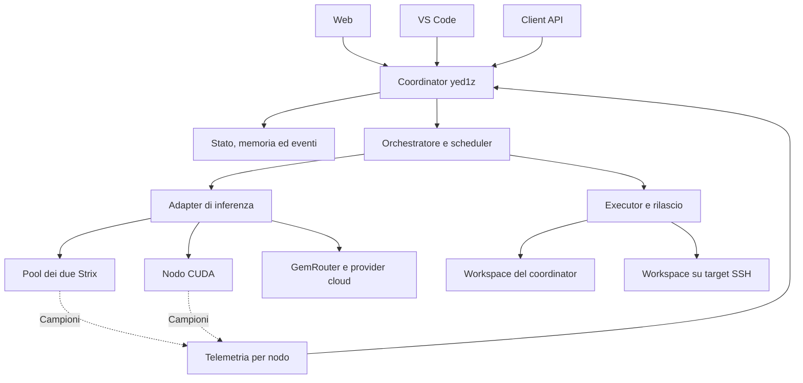
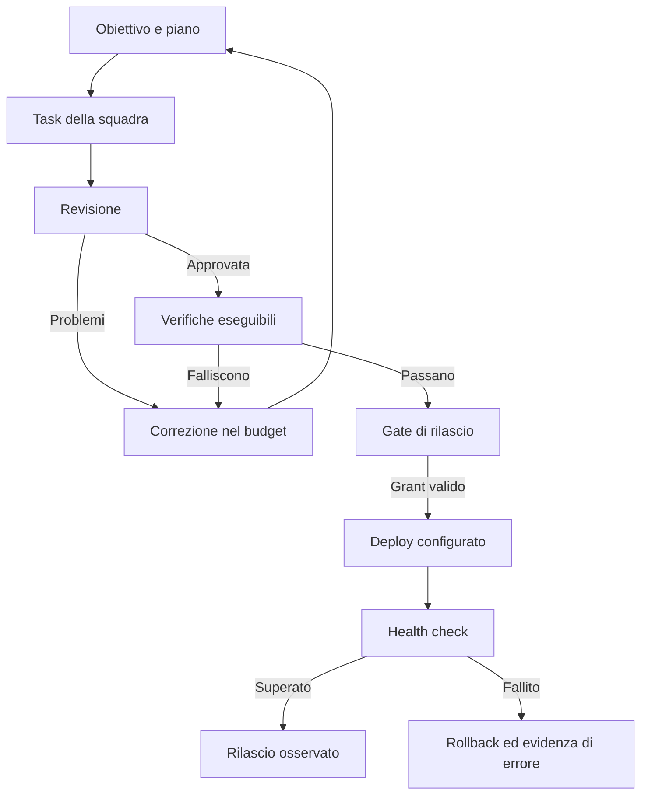

# Architettura di yed1z Control Room 0.3

**Progetto:** un ambiente di lavoro condiviso per comandare un team di agenti,
usare modelli distribuiti e controllare l'infrastruttura da web e VS Code.

**Stato del documento:** descrive il codice della release 0.3, le sue scelte e i
confini effettivi. Le evoluzioni successive sono indicate separatamente. La
disponibilità del codice e il superamento dei test locali non equivalgono a un
collaudo o a una distribuzione su `yed1z.ai`.

## 1. Il prodotto parte dal progetto dell'utente

L'unità principale di lavoro è il **progetto**, con conversazioni, documenti,
metodi approvati, modelli assegnati ai ruoli e un workspace di esecuzione. L'utente
parla con l'orchestratore primario e vede, nello stesso spazio, che cosa sta
facendo la squadra e quali risorse sta usando.

Il percorso previsto è: formulare un obiettivo, consentire le azioni necessarie,
seguire il piano e le evidenze, intervenire quando serve e ottenere un risultato
verificato. Se esiste una ricetta di rilascio autorizzata, il percorso arriva
all'esecuzione del deploy e al controllo di salute. Se mancano target, credenziali,
verifiche o una ricetta di rilascio, il sistema deve rendere visibile quel limite.

Questo richiede più della condivisione di una finestra chat. Servono stato del
lavoro, dipendenze, esclusione delle risorse incompatibili, contesto selezionato,
storia delle decisioni e verifiche indipendenti dalle dichiarazioni del modello.
Questi elementi appartengono al servizio yed1z; un cambio di modello non li
trasferisce in un'altra applicazione.

Le due modalità sono distinte:

- **Chat:** conversazione con cronologia e contesto di progetto. I modelli HTTP
  non ricevono tool di esecuzione.
- **Missione:** ciclo di pianificazione, assegnazione, modifica, revisione e
  verifica, con eventuale rilascio. Richiede un operatore fidato e un target
  configurato. Le CLI native hanno ulteriori limiti descritti più avanti.

I tipi condivisi in [`src/contracts.ts`](../src/contracts.ts) definiscono gli
oggetti del prodotto. La UI e il server usano lo stesso contratto.

## 2. La distribuzione fisica è parte del modello dati

Un nodo, un modello e un agente sono tre cose differenti. Il modello di
esecuzione mantiene esplicite queste differenze:

| Oggetto | Significato | Esempio nella vostra infrastruttura |
| --- | --- | --- |
| Nodo | Macchina fisica o risorsa remota osservabile | `01-EVO-X3`, `02-EVO-X3`, `aireward-llm`. |
| Collegamento | Relazione di rete configurata o osservata | Collegamento fra i due Strix; LAN verso il nodo CUDA. |
| Provider | Servizio che riceve richieste di inferenza | Engine Strix, engine CUDA, Ollama, GemRouter, API cloud. |
| Account | Identità o credenziale con cui si usa un provider | Due account Codex distinti; due connessioni API autorizzate. |
| Route modello | Coppia modello/account con capacità e risorse associate | Qwen tramite un account, sui nodi dichiarati. |
| Gruppo di risorse | Capacità concorrente condivisa che deve essere prenotata | Memoria del primo Strix, memoria del secondo, memoria della 3090. |
| Target di esecuzione | Macchina e radice di workspace autorizzate per i tool | Una directory di progetti sul coordinator o su un host SSH. |
| Task agente | Incarico con ruolo, istruzioni, dipendenze e route | Ricercatore, sviluppatore, revisore. |
| Ricetta | Operazione definita dall'operatore, con argv e limiti | Test, build, attivazione engine, pubblicazione, rollback. |

Un modello distribuito sui due Strix può esporre **un solo endpoint HTTP**, ma
occuparne entrambi. Due nomi di modello possono invece contendersi la stessa
memoria della 3090. Il numero di URL o di etichette nel selettore non rappresenta
quindi il numero di risorse disponibili.

Anche la macchina del modello e quella del codice sono indipendenti. Un modello
servito da GemRouter può usare tool su un workspace SSH del cluster; un modello
sulla 3090 può produrre codice destinato a un workspace del coordinator. L'utente
sceglie il progetto e la squadra; la configurazione esplicita decide dove passa
l'inferenza e dove vengono eseguite le azioni.

### Topologia da preservare

Il coordinator documentato è `01-EVO-X3`. Il secondo Strix è identificato come
`02-EVO-X3`, con alias SSH `02-evo-x3-tb` nelle informazioni disponibili. Il nodo
CUDA è `aireward-llm`, indicato dall'utente a `192.168.178.47`.

Questi riferimenti non sostituiscono un inventario live. Gli indirizzi LAN storici
dei due Strix presentano associazioni discordanti di `.67` e `.77`: il progetto
non deve risolverle per supposizione. I collegamenti del file di esempio sono
marcati come configurazione, non come misure di raggiungibilità, velocità o
latenza. Il collegamento al coordinator non ha permesso il collaudo operativo
durante questa consegna.

La mappatura degli engine e delle porte ricavata dal gateway è in
[`ADAPTERS.md`](ADAPTERS.md). I riferimenti ai sorgenti sono alla fine del documento.

## 3. Un unico servizio di coordinamento, scritto in TypeScript

La 0.3 usa un **monolite modulare TypeScript** su Node 24. Server HTTP, scheduler,
orchestratore, memoria, adapter, runner e client VS Code sono nello stesso
repository e nello stesso linguaggio applicativo. Il frontend è TypeScript
compilato per il browser, con HTML e CSS per struttura e presentazione.

La scelta riduce la duplicazione dei contratti e delle regole fra Python,
TypeScript ed estensione. Mantiene il deploy del coordinator semplice: non
aggiunge Redis, un broker di code o un database vettoriale separato come
prerequisiti. I motori di inferenza esistenti conservano il proprio stack e le
proprie ottimizzazioni GPU; l'harness li tratta attraverso adapter.

Il singolo servizio residente dell'harness è il coordinator. Il runner remoto
viene avviato su richiesta via SSH e non apre un server HTTP. Gli engine GPU,
il controller CUDA che serve al model switching e il tunnel restano processi
infrastrutturali necessari: non diventano duplicati solo perché il prodotto ha
un solo ingresso.

### Confini dei moduli

| Modulo | Responsabilità |
| --- | --- |
| [`server.ts`](../src/server.ts) | Autenticazione, API, autorizzazioni HTTP, eventi e asset della UI. |
| [`store.ts`](../src/store.ts) | Stato persistente, transazioni, identità, segreti, recupero al riavvio. |
| [`catalog.ts`](../src/catalog.ts) | Provider, account, modelli, quote e telemetria normalizzata. |
| [`scheduler.ts`](../src/scheduler.ts) | Prenotazioni atomiche dei gruppi di risorse. |
| [`orchestrator.ts`](../src/orchestrator.ts) | Missioni, ruoli, dipendenze, budget, approvazioni e ciclo di riparazione. |
| [`context.ts`](../src/context.ts) | Composizione deterministica e ispezionabile del contesto. |
| [`knowledge.ts`](../src/knowledge.ts) | Allegati, memorie, versioni, indice lessicale e vettori. |
| [`adapters/`](../src/adapters/) | Trasporti di inferenza, runtime ufficiali, lifecycle e sonde. |
| [`execution/`](../src/execution/) | Workspace, ricette, runner, processi e verifiche di rilascio. |
| [`web/`](../web/) e [`vscode/`](../vscode/) | Due accessi alla stessa interfaccia e allo stesso stato server. |

### Persistenza e disponibilità

SQLite conserva entità, autenticazioni, eventi, revisioni delle memorie, chunk e
vettori. Il servizio usa WAL, transazioni e un lock della directory di stato.
L'archivio degli allegati contiene blob indirizzati dal loro hash. I segreti dei
provider sono cifrati con AES-GCM usando una master key locale separata dal
database; il database nel suo insieme non è cifrato.

**La release ha un solo coordinator attivo e non offre alta disponibilità.**
Le code e le prenotazioni attive appartengono al processo corrente. Lo stato
persistito consente di ricostruire il lavoro e segnalarne l'interruzione, non di
trasferire automaticamente un processo in corso su un secondo coordinator.
Il modello evita due schedulatori indipendenti che prenotino la stessa GPU o
scrivano sullo stesso checkout.

## 4. Come si assegnano le risorse

Prima di usare una route, lo scheduler raccoglie i gruppi espliciti della route
e quelli associati ai suoi nodi. Prenota l'insieme **in modo atomico**: una
richiesta per entrambi gli Strix non ne trattiene uno mentre attende l'altro.

La coda evita che nuove richieste per le stesse risorse scavalchino continuamente
una richiesta già bloccata. Risorse indipendenti possono procedere. La capacità
è configurata dall'operatore; gli engine commutabili richiedono esclusività,
con `capacity: 1` sui gruppi interessati.

La prenotazione copre il controllo di readiness, l'eventuale attivazione e la
generazione. Le richieste embedding e quelle della facade API passano attraverso
lo stesso scheduler: indicizzare documenti non costituisce un percorso laterale
per saturare un nodo già occupato da una conversazione.

Tre limiti rimangono espliciti:

1. La capacità non viene dedotta automaticamente dalla VRAM libera o dal numero
   di modelli nel catalogo. Occorre dichiarare risorse e incompatibilità reali.
2. Lo scheduler protegge le richieste che attraversano questo coordinator. Uno
   script esterno o il vecchio gateway possono ancora spegnere un engine se
   mantengono una seconda autorità di commutazione.
3. Il costo di caricamento di un modello non viene ancora ottimizzato con un
   algoritmo di affinità, prefetch o migrazione automatica. La release applica
   prenotazioni e readiness corretti; non dichiara un'ottimizzazione globale
   dimostrata dei tempi del cluster.

La discovery dei modelli rimane una lettura del catalogo. Non avvia e non ferma
engine. La readiness deve invece interrogare l'engine e verificare l'ID atteso:
un catalogo statico del node agent può elencare modelli anche quando sono spenti.

## 5. Il ciclo completo di una missione

Una missione conserva obiettivo, proprietario, progetto, permessi, limiti, task,
dipendenze, risultati ed evidenze. Il modello primario produce un piano
strutturato; il codice valida il piano, compresi riferimenti e cicli del grafo.
I task possono usare modelli differenti per ricerca, sviluppo e revisione.

Il flusso effettivo è il seguente:

1. **Validazione iniziale.** Il server controlla utente, progetto, route, target,
   allegati e ricette di verifica. Una conversazione non avvia due missioni
   contemporanee.
2. **Workspace esclusivo.** La missione acquisisce una lease di scrittura prima
   di iniziare il lavoro. Anche directory padre e sottodirectory sovrapposte
   condividono l'esclusione. I progetti disgiunti possono procedere.
3. **Piano.** L'orchestratore produce un insieme limitato di task e dipendenze.
   Un piano malformato può essere corretto in un ciclo successivo, entro i limiti
   della missione.
4. **Squadra.** I ricercatori indipendenti possono eseguire letture in parallelo.
   Gli sviluppatori che scrivono nello stesso checkout vengono eseguiti uno alla
   volta. Il modello di un task in coda o esplicitamente in pausa può essere
   cambiato dall'utente.
5. **Esecuzione.** I modelli HTTP usano i tool dell'harness; le CLI native usano
   il proprio runtime con le limitazioni previste dall'adapter. File, comandi e
   risposte sono registrati come risultati o evidenze del task.
6. **Revisione.** Un ruolo di revisore esamina il lavoro e produce un giudizio
   strutturato. Può essere assegnato a un modello diverso. Il suo giudizio è
   registrato, ma non sostituisce un test.
7. **Verifica.** Vengono eseguite le ricette dichiarate dal progetto. Exit code,
   errori, timeout e output sono fatti osservati. La frase «tutto funziona» di un
   modello non converte un test fallito in una verifica riuscita.
8. **Riparazione.** Errori del lavoro, problemi di review o test falliti possono
   alimentare un nuovo ciclo di pianificazione e correzione. Le evidenze
   precedenti rimangono disponibili. Iterazioni, chiamate e output hanno limiti.
9. **Consegna o rilascio.** Senza ricetta di deploy, il risultato è consegnato nel
   workspace e viene indicato come non distribuito. Con una ricetta, la missione
   attende il grant o usa quello esplicitamente concesso dall'operatore alla
   missione.
10. **Controllo del rilascio.** L'executor ripete le verifiche previste, esegue
    i passaggi della ricetta e verifica la salute dal nodo di esecuzione. In caso
    di errore esegue il rollback autorizzato se configurato, conservando lo stato
    di fallimento anche quando il rollback riesce.

Il budget impedisce una reiterazione senza limite. Per le invocazioni HTTP il
coordinator prenota anche il budget di output disponibile fra richieste
concorrenti; l'uso viene aggiornato dai contatori del provider o, quando assenti,
da una stima dichiarata. Il contatore della missione non è una fattura né una
lettura autorevole del saldo commerciale dell'account.

### Interventi dell'utente

Sono implementati pausa, ripresa, annullamento e nuove istruzioni sia sulla
**missione intera**, sia sui singoli task di ricerca e sviluppo. Orchestratore,
revisore e rilascio si controllano attraverso la missione. La pausa interrompe
la chiamata o il processo in corso: non equivale a sospendere un processo nel
punto esatto e conservarne la memoria. Le modifiche già completate rimangono
nel workspace.

La pausa di un task cancella il suo sottocontroller. Gli altri ricercatori già
avviati possono terminare; i task indipendenti ancora eseguibili proseguono,
mentre i dipendenti aspettano il risultato necessario. Quando l'agente è fermo,
l'utente può cambiare route, aggiungere istruzioni e rimetterlo in coda. Questa
ripresa ricompila il contesto con le evidenze precedenti e richiede di ispezionare
i file effettivi; conserva il budget consumato e avvia un nuovo tentativo, senza
reinviare automaticamente lo stesso RPC. Un'istruzione a un task in coda viene
applicata subito; a un task attivo ne richiede la pausa e una ripresa esplicita.

L'annullamento di un task attende la conclusione delle altre attività già
avviate nel batch e mette la missione in pausa, affinché l'utente indirizzi
nuovamente l'orchestratore. Il ramo annullato non viene sostituito di nascosto
con un altro agente. Non sono implementate la modifica retroattiva di un task
già concluso e l'invalidazione automatica di tutti i risultati che ne dipendono.

Alla ripresa della missione viene ricostruito il lavoro a partire dalle evidenze
e dal contesto persistito. Il sistema non ripete automaticamente un deploy
interrotto come se non fosse mai avvenuto. Un esito remoto incerto conserva
priorità sulla richiesta di pausa: deve essere riconciliato prima di ripetere
l'azione.

### Riavvio ed esiti incerti

Al riavvio, i task che risultavano in esecuzione vengono marcati come interrotti;
le approvazioni pendenti scadono. Una perdita del canale SSH o del runtime nativo
durante un'azione può lasciare un esito incerto: il processo remoto potrebbe
aver già prodotto un effetto prima della disconnessione. Il sistema conserva
questa incertezza e interrompe il ciclo automatico.

La release non promette esecuzione «exactly once» di azioni arbitrarie. Per
ottenere quella proprietà, ogni sistema esterno interessato dovrebbe accettare
chiavi di idempotenza o fornire operazioni di riconciliazione. Le ricette di
produzione devono essere progettate per controllare lo stato corrente prima
di ripetere un'azione.

## 6. La memoria del progetto

La memoria è un archivio recuperabile e revisionabile. Non modifica i pesi del
modello, non esegue fine-tuning e non trasforma automaticamente ogni frase della
chat in una regola permanente.

### Quattro livelli distinti

| Livello | Contenuto e uso |
| --- | --- |
| Conversazione | Messaggi e misure delle risposte, conservati per il proprietario. |
| Allegati | Testo e Markdown caricati esplicitamente, con hash, proprietario e progetto. |
| Memorie | Metodi, decisioni, brief e documenti con stato, scope, revisione e fonti. |
| Contesto del task | Selezione temporanea delle fonti da inviare al modello per un incarico preciso. |

Dopo una missione verificata il revisore può proporre un **metodo candidato**.
La proposta non diventa automaticamente parte del comportamento futuro. Le
voci approvate sono recuperabili per nuovi task; quelle candidate o ritirate
rimangono fuori dal contesto operativo.

Le memorie sono private per impostazione iniziale. La condivisione nel progetto
è un'azione esplicita riservata a chi ne ha autorità. Versioni e riferimenti alle
fonti permettono di capire perché una procedura è presente. Dimenticare una
memoria elimina quella voce, le sue revisioni e i vettori: non elimina anche
le conversazioni o gli allegati che possono documentare la decisione originaria.

### Ricerca lessicale e vettoriale nello stesso servizio

La ricerca lessicale usa SQLite FTS5. Quando il progetto seleziona una route
embedding, i chunk vengono trasformati in vettori da **quel modello effettivo**,
attraverso Ollama o un endpoint compatibile. I vettori non sono generati da
hash, etichette o valori simulati.

La ricerca combina la graduatoria lessicale con la similarità coseno dei vettori.
Le autorizzazioni vengono applicate alle fonti recuperabili prima di costruire
il contesto. Non è sufficiente che due utenti usino lo stesso modello embedding
per rendere visibili le loro memorie reciproche.

L'indice vettoriale della 0.3 è semplice e locale, con scansione dei vettori
ammissibili. Non è un motore ANN dedicato per milioni di documenti. La scelta
evita un altro servizio per la dimensione iniziale del prodotto; l'evoluzione
verso un indice più grande deve preservare identità, ACL, revisioni e cancellazione.

### Il compilatore del contesto

Per ogni task vengono considerati istruzioni dell'harness, richiesta corrente,
brief del progetto, memorie approvate, risultati delle dipendenze, allegati,
cronologia recente e fonti recuperate. La richiesta attuale viene preservata;
le fonti opzionali eccedenti il budget sono escluse con una motivazione visibile.

La stima usa byte UTF-8 e overhead del messaggio, con margine sulla finestra e
riserva di output. **Non usa il tokenizer specifico di ogni modello.** Il
rapporto di contesto mostra fonti, stime, inclusioni ed esclusioni; non spaccia
questi valori per contatori del provider.

Documenti, output dei tool e relazioni dei compagni non acquisiscono autorità di
istruzione di sistema. La memoria non può autorizzare nuovi comandi, cambiare
target o approvare un rilascio. Una richiesta obbligatoria troppo grande viene
rifiutata esplicitamente invece di essere troncata in silenzio.

## 7. Un cockpit comune a web e VS Code

La UI concentra l'uso ordinario nella Control Room:

- progetto e conversazioni personali nella navigazione;
- stato dei nodi e delle risorse a colpo d'occhio;
- dialogo con l'orchestratore e selezione di modello/account;
- squadra, dipendenze e avanzamento a fianco della conversazione;
- dettaglio di ogni task con risultato, attività, contesto ed evidenze;
- sezioni dedicate a infrastruttura, conoscenza, connessioni e rilasci.

Il grafo dei task rappresenta le dipendenze effettive, non un'animazione
indipendente dal backend. L'utente può vedere quale modello e quale account
sono assegnati a un ruolo. Il numero di task riusciti, la fase e i budget restano
distinti: una percentuale di task completati non equivale a una percentuale
scientifica di progetto consegnato.

L'aggiunta di modelli parte dalla connessione: preset, URL, eventuale chiave e
discovery. GemRouter compare come provider di inferenza selezionabile. I campi
di topologia, capacità e policy sono configurazione dell'operatore e rimangono
separati dal gesto quotidiano di scegliere un modello.

Web e VS Code caricano la stessa interfaccia. Nel browser il server usa una
sessione cookie HttpOnly; nell'estensione la chiave personale rimane nel
SecretStorage e il trasporto passa dall'extension host. Il webview non riceve
la chiave e non effettua connessioni dirette ai provider. Il workspace VS Code
non determina automaticamente il target remoto del progetto.

La riconnessione degli eventi usa un cursore. Risultati e stato durevole vengono
ricaricati dal server; i frammenti di streaming transitori non sono un log di
esecuzione completo. Una parte del flusso può essere persa durante una
disconnessione, mentre il risultato finale e le evidenze persistite rimangono
la fonte da consultare.

La UI è stata verificata mediante test DOM e bridge. Il collaudo visivo in un
browser reale e in una finestra VS Code non è stato completato in questa
sessione. Non viene quindi dichiarata una parità visiva o funzionale già
dimostrata con Codex o Copilot.

## 8. Telemetria, prestazioni e quote

Il monitor distingue tre categorie:

1. **Misure del nodo:** CPU, RAM, GPU, temperatura, potenza e memoria quando
   disponibili dalla sonda, con timestamp e stato del nodo.
2. **Misure dell'invocazione:** input, output, cache, durata, primo token e tempi
   dell'engine quando presenti.
3. **Uso del lavoro:** chiamate e token dei task e della missione, aggregati
   separatamente dalla finestra di contesto di una singola richiesta.

I campioni hardware vengono aggiornati con polling. La UI mantiene anche una
breve storia della sessione per i grafici; la release non installa una TSDB
hardware né conserva una serie storica completa per mesi. Le misure delle
risposte restano invece associate alle conversazioni persistite.

Il tempo al primo token misurato dal gateway include attesa e trasporto. Il
prefill e la velocità di decode richiedono dati dell'engine. Token di contesto,
RAM e KV cache non sono la stessa misura. Un campione di utilizzo GPU generale
non dimostra da solo quanta parte del carico appartenga a una singola risposta,
soprattutto se esistono processi esterni al nuovo scheduler.

I fallback fissi trovati nelle sonde legacy non vengono promossi a telemetria
misurata. Dati mancanti, non verificati o non recenti devono rimanere distinguibili
da un valore reale pari a zero. Il runner TypeScript fornisce una sonda alternativa
senza un nuovo servizio residente; richiede comunque installazione e accesso al
nodo reale.

Le quote sono quelle osservate dal provider o dalla CLI. Valori non restituiti
rimangono sconosciuti. Il cambio di account conserva la conversazione e vale
per il lavoro successivo; un 429 non provoca una rotazione automatica con replay
di azioni già svolte. Le finestre Codex rimangono separate; le quote interne di
GemRouter restano di competenza di GemRouter, salvo ciò che la sua API espone.

## 9. Utenti, identità e confini di esecuzione

| Ruolo | Uso previsto |
| --- | --- |
| Viewer | Lettura dei dati autorizzati, senza nuove attività o mutazioni. |
| Member | Chat HTTP, proprie conversazioni e conoscenza nei progetti accessibili. |
| Operator | Operatore fidato: configurazioni autorizzate, missioni, runtime e rilasci. |
| Admin | Amministrazione degli utenti e configurazioni, con privilegi di operatore fidato. |

Appartenere a un progetto non rende leggibili le conversazioni o gli allegati
personali degli altri membri. La condivisione delle memorie e degli account
HTTP è esplicita. L'API filtra eventi e dati per il proprietario e controlla
l'accesso al progetto. Una sessione cookie non autorizza mutazioni da un'origine
diversa; i client nativi usano Bearer senza trasferire il token nelle query.

L'esecuzione di codice è riservata agli operatori fidati. Un controllo sui
percorsi dei tool impedisce gli accessi fuori workspace previsti da quei tool,
ma **non limita i privilegi di un processo arbitrario** avviato con lo stesso
UID. Anche un test npm modificato nel repository può leggere file accessibili
all'account di servizio. Cifrare i segreti nel database non protegge da un
processo che può leggere sia database sia master key.

Per utenti o repository non fidati occorrono target con utenti Unix, container
o VM isolati, senza mount dello stato del coordinator. La 0.3 non automatizza
questa segregazione. Un progetto deve preferire una radice dedicata come
`/home/funboy/yed1z-workspaces`, creata dall'operatore, non l'intera home che
contiene configurazioni e credenziali. La creazione di un progetto può preparare
una sottodirectory validata della radice esistente.

Le ricette di attivazione, deploy e rollback riservate ai controller non sono
disponibili al tool generico dei modelli. Questa separazione protegge il flusso
applicativo; non sostituisce l'isolamento OS quando gli script di progetto sono
eseguiti con privilegi elevati. Dettagli e protocollo runner sono in
[`EXECUTION.md`](EXECUTION.md).

## 10. Provider e runtime: capacità effettive

Gli adapter HTTP supportano OpenAI compatibile, Responses, Gemini e Ollama. La
route conserva modello, account, endpoint, capacità e gruppi di risorse.
GemRouter è una connessione OpenAI compatibile: non viene inglobato come un
secondo orchestratore del prodotto.

Codex viene usato tramite l'app-server ufficiale, con profilo account isolato,
login guidato e quote osservate. Le operazioni sullo stesso account sono
serializzate. Antigravity usa la CLI ufficiale ACP con login già effettuato sul
server; non offre in questa integrazione OAuth guidato, quote numeriche,
multi-account isolato o una modalità di sola lettura verificata.

La CLI vede il filesystem della macchina che la avvia. Il coordinator limita
quindi i suoi task nativi ai target locali. Per un workspace SSH si usano i tool
remoti dell'harness con un modello HTTP; il percorso remoto non viene passato
come se fosse locale.

La continuità comune della 0.3 è la conversazione canonica e il contesto
ricompilato. Il contratto dell'adapter nativo accetta un `resumeId`, ma
l'orchestratore attuale non conserva e riutilizza un cursore di sessione nativo
fra i task. Non viene promessa la conservazione della cache o dell'intero stato
interno di Codex/Antigravity cambiando account o modello.

Le CLI e i loro plugin mantengono i propri confini operativi. L'harness inoltra
le approvazioni supportate e gestisce interruzione e timeout; non controlla
automaticamente ogni effetto di qualunque estensione MCP esterna.

## 11. API e integrazioni

Il contratto del prodotto è descritto in [`API.md`](API.md). Comprende progetti,
conversazioni, missioni, eventi, account, catalogo, memorie, allegati e operazioni
di rilascio. Web e VS Code lo usano entrambi.

La facade standard espone `/v1/models` e `/v1/chat/completions` per inferenza
testuale con Bearer, usando account, quote e scheduler del coordinator. Gli ID
del catalogo rappresentano route modello/account. Non è dichiarata una
compatibilità universale con ogni endpoint OpenAI: tool, missioni e CLI native
usano l'API dell'harness; la facade testuale rifiuta tool arbitrari.

L'API non è un endpoint pubblico per eseguire comandi di shell, scegliere host
SSH o leggere percorsi assoluti. Gli adapter estendono le capacità del servizio
attraverso configurazione e codice revisionabili.

## 12. Migrazione e percorso verso l'uso operativo

La migrazione deve distinguere dati, ingressi e autorità sui nodi. È descritta
operativamente in [`MIGRATION.md`](MIGRATION.md).

| Fase | Risultato da ottenere prima di avanzare |
| --- | --- |
| Inventario | Host, alias, porte, processi, dipendenze e proprietari delle commutazioni verificati. |
| Installazione separata | Nuovo coordinator e nuovo stato senza sovrascrivere la 0.2. |
| Mappatura | Nodi, risorse, engine, GemRouter, account e workspace corrispondono all'impianto reale. |
| Migrazione delle chat | Importazione esplicita per proprietario, ricevute ripetibili e controllo della cronologia. |
| Collaudo | Web e VS Code, utenti, quote, telemetria, concorrenza, SSH, errori e ripresa verificati sui nodi. |
| Rilascio di prova | Test, deploy, salute e rollback eseguiti su un ambiente di prova concreto. |
| Passaggio dell'ingresso | Vecchi task drenati, backup conservato, tunnel e client diretti a un solo coordinator. |
| Dismissione | Servizi precedenti rimossi solo dopo averne verificato l'assenza di dipendenze. |

Il database 0.2 viene importato in sola lettura, per un proprietario selezionato.
Credenziali, sessioni native e turni attivi non vengono convertiti in nuove
autorizzazioni. I backup della 0.3 devono comprendere database, master key,
configurazione, profili account e allegati. Il comando di backup del database
non costituisce da solo un backup completo dell'installazione.

### Evoluzioni successive, non presenti nella release

Il prodotto può crescere mantenendo questo modello centrale: worktree per task
con integrazione controllata, revisione dei risultati già conclusi e delle
dipendenze del grafo, target isolati
provisionati automaticamente, tokenizer specifici, memoria a scala maggiore,
telemetria storica, ricette di rilascio più ricche e integrazione SSO. Un futuro
coordinator ad alta disponibilità richiederà inoltre lease e code persistenti
con fencing fra istanze: non basta avviare una seconda copia del processo.

Queste estensioni devono preservare le proprietà già introdotte: un'identità
unica del progetto, provenienza delle decisioni, distinzione fra modello e
macchina, autorizzazioni fuori dal prompt e prova osservabile del risultato.
Il dettaglio delle differenze fra obiettivo, 0.2 e 0.3 è in
[`GAP_AUDIT.md`](GAP_AUDIT.md).

## Riferimenti e provenienza

- [Gateway originale, snapshot di riferimento](https://github.com/0xfunboy/StrixHaloCluGateway/blob/1af039fa7cdd3e0204e7da20d4036135c7f873ce/README.md): punto di partenza per routing e infrastruttura.
- [HaloClu, conversazioni](https://github.com/0xfunboy/StrixHaloClusterGLM/blob/071c2c8a59f0dde28e460dc90f7393c8665f4a6a/docs/CONVERSATIONS.md): precedente gestione delle conversazioni.
- [Workbench Kirei](https://github.com/0xfunboy/StrixHaloClusterDS41Kirei/blob/62a7dffc28d328d70951ed918fcae4ea670ecb3e/workbench/app.py): componente precedente dell'ecosistema.
- [GemRouter, routing Codex](https://github.com/0xfunboy/GemRouterFE/blob/6d8a560b615faf34bbfe0d10a3533f4650f3ca81/src/codex/routes.ts): servizio trattato come provider di inferenza.
- [Ollama Chat](https://docs.ollama.com/api/chat), [Embedding](https://docs.ollama.com/api/embed) e [Catalogo](https://docs.ollama.com/api/tags): contratti dei relativi adapter; ulteriori dettagli in `ADAPTERS.md`.
- [`tests/control-plane.test.ts`](../tests/control-plane.test.ts): verifiche del flusso completo, ACL, quote, memoria, scheduler, crash e rilascio con fixture locali.

I moduli di protocollo riutilizzati da HaloForge sono TypeScript con provenienza
e licenza incluse in `src/adapters/vendor/`. La release non incorpora una fusione
integrale dei sorgenti OpenCode, Pi, Goose e DeepSeek Harness.
