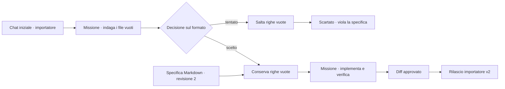

# yed1z 1.0 — Il progetto, l’orchestratore e il percorso fino alla produzione

**Piano di prodotto e di realizzazione · 18 novembre 2026**  
Base di confronto: gateway Python alla revisione `1af039f`, ZIP Control Room `4a5c0d3`, checkout installato `d8bf705`. Le caselle di collaudo si chiudono con prove sulla revisione candidata.

## 1. L’esperienza che deve riuscire

Apro il mio progetto da VS Code o da yed1z.ai. Ritrovo la conversazione, i file, i metodi di lavoro e il punto a cui ero arrivato. Parlo con il mio orchestratore primario. Posso passare da GPT a Gemini, a un altro account o al mio Qwen locale. Il progetto ricorda cosa abbiamo deciso, cosa abbiamo già provato e cosa resta da fare. Sotto la risposta vedo chi l’ha generata, dove e con quali risorse.

Quando chiedo di costruire qualcosa, vedo la squadra formarsi. Vedo due agenti imboccare rami diversi, uno aspettare la GPU e l’altro lavorare sui file. Posso aprire ciascun agente, dargli un’indicazione o cambiare la sua assegnazione. Quando un test fallisce vedo il ritorno allo sviluppo. Quando passa, seguo lo stesso lavoro fino all’artefatto distribuito e alla verifica in produzione. Giorni dopo, dal rilascio posso risalire alla domanda e alle decisioni che l’hanno prodotto.

**Prima prova di design.** Mostrare la schermata di un progetto in corso a Funboy e Cooper. Dalla stessa vista devono poter indicare chi lavora adesso, cosa aspetta l’altro agente, su quali macchine si svolge il lavoro e quale decisione spetta a loro. La seconda prova parte da una consegna di ieri e richiede di trovare il test fallito, la correzione e la fonte che ha orientato quella scelta.

## 2. Da dove viene ciascun requisito

I riferimenti di riga puntano all’[esportazione locale della conversazione con Astra](../../ChatGPT_Capire-Gli-Agent-Harness_20261118-0136.md). Le richieste sono nei sette interventi dell’utente. I resoconti di versione nelle risposte di Astra servono a ricostruire la successione delle consegne.

| Richiesta dell’utente | Conseguenza per il prodotto | Prova finale |
|---|---|---|
| Riga 7 · GPT, Gemini e Qwen locale, API key e login, cambio senza esportare memoria e chat | Il progetto e la conversazione hanno identità indipendenti da provider, runtime e account | P1 |
| Righe 293–325 · usare Qwen per coding, scegliere il meglio di OpenCode, DeepSeek Harness, Pi e Goose, monorepo, OAuth, quote e squadre | Adapter verificati anche sui tool, ruoli con modelli diversi, permessi, contesto portabile, più identità per provider | P1, P2, P4 |
| Riga 699 · plug-in VS Code | Il pannello dell’editor è una superficie completa di lavoro, con selezione dell’editor, diff e comandi sugli agenti | P1, P3, P6 |
| Riga 743 · archivio scaricabile | Repository ricostruibile, distribuzione completa e VSIX installabile | P9 |
| Righe 805–825 e 834–870 · unificare portali, servizi, quote e misure. Vedere carico live mentre si chatta e consumi sotto ogni risposta | Stessa origine e stesso stato per monitor, chat, API e VS Code. Inventario di client e servizi. Limiti degli account visibili durante la scelta | P2, P5, P8, P9 |
| Righe 1087–1089 · infrastruttura distribuita, utenti, storico, allegati MD, metodi, iterazione fino alla produzione e «totale controllo anche visual grafico» | Topologia fisica accanto alla conversazione, grafo dei task e storia delle decisioni. GemRouter è un provider selezionabile. Un servizio residente dell’harness, adapter e applicazione in TypeScript | P1, P3, P4, P5, P6, P7 |
| Righe 1375–1376 · configurazione immediata, contesa, estetica del vecchio HUD, animazioni di agenti/modelli/knowledge, «come stai?» rapido, handoff | Ingresso diretto al collegamento, coda spiegabile, movimenti sincronizzati con eventi, percorso breve per la chat, collaudo grafico e operativo | P2, P3, P4, P6, P9 |

### L’evoluzione da cui ripartire

| Tappa | Cosa porta nel prodotto definitivo |
|---|---|
| **StrixHaloCluGateway originale** · Git da `565f23e` a `1af039f` | Il gateway serviva client reali, arbitrava switch e streaming, esponeva catalogo e alias e mostrava un cluster, non un singolo endpoint. Il commit `c7d459b` introduce chassis, quadranti e pipeline. `697f029` aggiunge Aireward. `e3fc1ff` e `1af039f` documentano compatibilità dello streaming e arbitraggio tra processi. Riferimento riproducibile: `git show 1af039f:gateway.py`, in particolare `acquire_model`, `acquire_switch_file_lock` e `GatewayHandler`. |
| **HaloForge 0.1** · Astra, righe 695–800 | Il punto d’ingresso richiesto è un’estensione installabile. Selezione del modello, lavoro sul repository e continuità della conversazione devono riuscire dentro l’editor. |
| **yed1z Unified 0.2** · Astra, righe 920–1023 | Il gateway Python teneva insieme cronologia server, chat Web, worker e VSIX. HaloClu forniva conversazioni, il workbench Kirei progetti e job, GemRouterFE esperienza con account e quote. Inventariare i dati realmente disponibili e la catena di import verso lo stato attuale. |
| **Control Room 0.3** · `1b51aa1` | Coordinator TypeScript, risorse distribuite, runner locale/SSH, contesto per task, verifiche, memorie e consegne costituiscono la base eseguibile. Conservare il rapporto fra utente, progetto, conversazione, run ed evidenze. |
| **0.4 e modifiche installate** · ZIP `4a5c0d3`, checkout `d8bf705` | Lo ZIP introduce Auto, wizard e alternative autorizzate. Il checkout integra l’HUD storico alla radice, modifica picker e integrazioni native, aggiunge dati di attività. Confrontare il bundle servito e il VSIX con la revisione candidata. La sola etichetta “0.4.0” identifica più comportamenti. |

**Decisione sui quattro harness.** Valutare ciascuna idea su un compito reale del progetto. Da OpenCode verificare navigazione del codice/LSP, sessioni e permessi per tool. Da DeepSeek Harness ricavare contratti sostituibili per adapter, tool e policy. Da Pi misurare selezione del contesto, riuso della cache quando osservabile e costo di ogni turno. Da Goose valutare estensioni MCP e automazioni anche oltre il codice. Registrare per ciascuna capacità cosa si riusa dal monorepo, cosa integrare, licenza, confini dei dati ed esito della prova. La scelta della libreria e l’eventuale esposizione di API aggiuntive sono decisioni tecniche da motivare. La responsabilità dello stato di progetto rimane al coordinator.

## 3. La schermata principale è il progetto

Il progetto si apre sull’ultima conversazione e sull’ultima posizione visitata. Una missione attiva o una decisione in attesa sono raggiungibili subito. L’operatore può aprire il cockpit a tutto schermo. L’ospite vede la proiezione pubblica del monitor, se abilitata. Usare la stessa grammatica grafica per questi ingressi.

```text
 yed1z  /  Progetto  /  Conversazione            [Cerca nel progetto]   Utente
 STRIX 01 ── USB4 ── STRIX 02       RTX 3090 · LAN       Coda · 1 in attesa
 ┌───────────────────┬─────────────────────────────────┬─────────────────────┐
 │ Progetti e storia │ Conversazione con il primario   │ Squadra             │
 │                   │                                 │                     │
 │ Oggi              │ Obiettivo                       │ Piano ✓             │
 │   Importazione    │ Risposta in streaming           │ ├ Analisi codice ✓  │
 │   ↳ correzione    │ modello/account · token · TTFT  │ └ Analisi test ●    │
 │ Ieri              │                                 │    ↳ Sviluppo attende│
 │   Prima consegna  │ [Scrivi…] [Modello] [Auto]      │ [Segui agente]      │
 └───────────────────┴─────────────────────────────────┴─────────────────────┘
 Percorso del progetto   Obiettivo → Piano → Analisi → Modifica → Test → Consegna
                         [Adesso]  [Esplora cronologia]  [Apri evidenza]
```

Questo è uno schema di composizione desktop con dati illustrativi. Il centro resta leggibile durante uno stream lungo. Il pannello squadra si espande in una **mappa del lavoro**. La barra fisica del cluster resta raggiungibile mentre esploro un task. In VS Code a 320–480 px vedo conversazione, modello/account, attività corrente e una sola azione di intervento. **Squadra**, **Percorso** e **Cluster** aprono lo stesso oggetto in dettaglio. Un file o una riga del diff apre la revisione pertinente nell’editor. Sul telefono il percorso diventa un elenco verticale con rientri per i rami.

### La mappa del lavoro deve raccontare ciò che è successo

Questa è la forma di una possibile storia del progetto. Ogni nodo rappresenta un oggetto apribile. Il piano proposto è visibile prima dell’esecuzione. I percorsi effettivi si costruiscono man mano che arrivano risultati.

```mermaid
flowchart LR
    O["Obiettivo in chat"] --> K["Fonti usate e contesto"] --> P["Piano del primario"]
    P --> A["Analisi del repository"]
    P --> B["Analisi dei test"]
    A --> D["Prima modifica"]
    B --> D
    D --> R["Revisione"] --> T["Test fallito"]
    T --> C["Correzione mirata"] --> V["Nuovo test superato"]
    V --> E["Diff e artefatto verificati"]
    E --> G["Approvazione"] --> S["Rilascio"] --> H{"Health check"}
    H -->|riuscito| F["Produzione verificata"]
    H -->|fallito| X["Rollback ed esito osservato"]
```



**Due scale di lettura.** In *Missione* si vedono ruoli, dipendenze e tentativi della singola esecuzione. In *Percorso del progetto* si vedono gli obiettivi nel tempo, le conversazioni da cui partono, le missioni che proseguono o cambiano direzione, i diff e i rilasci a cui sono arrivate. Scelgo **Come siamo arrivati qui?** su un artefatto e si evidenziano solo i suoi predecessori. Un bivio conserva motivo, autore o regola, revisione precedente e nuovo tentativo. Un cambio account sulla stessa chat è un evento di quella conversazione. Creare un ramo alternativo è una scelta distinta. Ogni ramo ha un’etichetta leggibile, un link stabile e un ritorno al punto di origine.

Esempio di navigazione a distanza di una settimana. In *Percorso del progetto* seleziono **Rilascio importatore v2**. La mappa mette in primo piano il cammino adottato e lascia apribile l’alternativa scartata. Apro **Conserva righe vuote**, leggo il vincolo nel Markdown allegato e ritrovo il messaggio in cui ho approvato la scelta. Posso seguire anche il primo tentativo e capire perché il team lo ha abbandonato. Tutti i nomi in questo esempio sono illustrativi.



Per disegnare il cammino servono riferimenti espliciti fra messaggio, missione madre, decisione, eventuale ramo, task, tentativo, fonte con revisione e artefatto. Registrare chi ha scelto, quando e perché. Usare gli eventi del coordinator per ricostruire passato e presente con la stessa sequenza. Per i progetti importati conservare i collegamenti documentati e marcare quelli che lo storico non consente di ricostruire.

**Un clic su un agente** apre obiettivo assegnato, dipendenze, modello/account richiesto ed effettivo, nodo di inferenza, workspace del runner, fonti e budget di contesto, ultimo evento, tool, file coinvolti ed esiti. Mostrare solo i comandi consentiti nello stato corrente: dare istruzioni, mettere in pausa, cambiare assegnazione, riprendere, annullare. Dopo una pausa evidenziare quali rami indipendenti continuano. Dal pannello posso risalire alla richiesta originale, aprire il diff o il test e tornare alla stessa selezione.

**Adesso e cronologia.** La posizione dei nodi resta stabile durante lo streaming. Il nuovo ramo compare accanto al padre. Un selettore temporale ricostruisce lo stato al momento scelto e un comando riporta al live. In consultazione storica le azioni operative si aprono sullo stato corrente esplicitamente identificato. Ridurre i progetti estesi per obiettivo e iterazione, espandere su richiesta e offrire ricerca per file, agente, consegna e decisione.

### Direzione artistica e movimento

Ripartire dai pannelli squadrati, dalle tracce luminose su fondo scuro, dallo schema USB4/LAN, dagli strumenti e dalle immagini dei due chassis del gateway. Usare i quadranti per misure fisiche effettive, il testo monospazio per numeri e identificatori e un carattere di lettura per conversazioni lunghe. Usare ciano per la selezione, un secondo accento per l’attività, ambra per l’attesa e indicatori con forma e testo per ogni esito. IT/EN, temi e intensità FX diventano preferenze condivise. Il frontespizio storico, la chat e il pannello dell’editor devono essere riconoscibili come il medesimo prodotto. [HUD e risorse originali](../static/index.html) · [Stili storici](../static/style.css)

| Evento osservato | Cosa si vede | Cosa apre |
|---|---|---|
| Recupero di allegati e memorie concluso | Le fonti effettivamente incluse confluiscono nel primario | Documento, revisione, motivo di inclusione o esclusione |
| Pianificazione avviata e piano disponibile | Prima si attiva il primario, poi si disegnano i rami delle dipendenze reali | Piano e variazioni ordinate nel tempo |
| Richiesta in coda / risorse concesse | Simbolo di attesa fermo sulla risorsa contesa. All’ammissione si evidenzia il percorso verso i nodi o il provider | Modello richiesto, scelto, alternative e motivo |
| Streaming della risposta | Un impulso discreto sulla tratta attiva. Il testo compare nella chat o nel task che lo ha prodotto | Risposta, account e misure dell’invocazione |
| Tool o verifica iniziati / terminati | Stato in corso fino all’esito del runner. Un fallimento apre il ramo di correzione | Comando autorizzato, file, risultato ed evidenza |
| Pausa, caduta del trasporto, rilascio | Si arresta il moto del ramo. Un esito incerto resta distinto da errore e successo | Ultimo effetto confermato, verifica necessaria, health o rollback |

Le animazioni raccontano stati pubblicabili del lavoro. Il dettaglio mostra piano, decisioni dichiarate, operazioni ed evidenze. Con movimento ridotto bastano testo, icone e contorni. Quando due agenti generano insieme devono essere distinguibili entrambi. Una misura mancante resta “—” con fonte e ultimo aggiornamento. Il componente attuale aggrega cinque fasi e il grafo attuale conosce già le dipendenze dei task. Estenderli con provenienza dei rami e storia tra missioni. [Attività](../web/activity.ts) · [Grafo e pannello agente](../web/app.ts)

## 4. I percorsi che l’harness deve sostenere

### Entrare, collegare e scegliere

1. **Accesso a yed1z.** Rientro con la mia identità e ritrovo i miei progetti. Dall’editor distinguo l’host dell’estensione, il gateway e il workspace attivo. Un errore del provider mi lascia nella sessione del portale.
2. **Collega modello** apre direttamente il percorso di connessione. Per un endpoint LAN servono tipo e indirizzo raggiungibile dal coordinator. Per un’API nota si chiede la credenziale. Per Codex si guida il login ufficiale con home privata per account. Per Antigravity si mostra chi deve autenticare il profilo sul servizio e si ritorna alla verifica. Errori, chiusura e rinnovo riprendono la stessa connessione. Evitare duplicati di account dopo un retry.
3. **Stato per uso concreto.** Distinguere trasporto, accesso, catalogo, risposta e capacità provate. Un modello può essere pronto per la chat e richiedere una prova per i tool. Consentire una prova minima esplicita con l’account indicato. Per le CLI verificare identità del processo, target compatibile e capacità effettiva del profilo. Il checkout ha esteso Antigravity alla chat. Verificare separatamente chat, scrittura, lettura vincolata, quote e isolamento per la versione installata.
4. **Cambio al prossimo turno.** Selezione unica di modello e account con disponibilità, quota/finestra osservata, reset e alternative autorizzate. Impostare separatamente “usa in questa conversazione”, “assegna a questo agente” e “salva nel progetto”. Un rifiuto di salvataggio deve restare visibile. Se l’utente vuole riservare un account per lavoro urgente, può escluderlo dal pool automatico e sceglierlo esplicitamente. I limiti locali e i dati commerciali osservati hanno indicatori distinti.
5. **Molti utenti e account.** Cercare e filtrare per provider, proprietario, progetto, stato e capacità. Distinguere permessi d’uso, gestione e rotazione. Gestire account personali e pool concessi a un team o progetto, con inviti, revoca e audit. Migrare le condivisioni esistenti esplicitamente. Cronologia personale e risorse pubblicate seguono i rispettivi permessi. Il coordinatore ricontrolla l’accesso all’uso, anche dopo una revoca.

### Parlare e proseguire lo stesso lavoro

In **Auto**, «come stai?» ottiene una risposta immediata del servizio anche con engine spenti. Una domanda tecnica ordinaria usa una completion. Una richiesta operativa avvia il percorso con gli strumenti previsti. In **Chat** la scelta esplicita prevale. Durante una missione **Chiedi** e **Dai istruzioni alla squadra** sono azioni distinte. Il testo, gli allegati e il punto di lettura sopravvivono a coda, errore e correzione della configurazione.

Sotto ogni risposta una riga compatta mostra modello/account effettivo, input/output, velocità e contesto usato/disponibile. Espandendo, vedo cache, coda, caricamento, tempo al primo token, prefill, decode, durata e fonte per misura. La carta dell’invocazione distingue token della singola chiamata, totale del task e finestra di contesto. Per un endpoint remoto si mostrano le misure restituite o misurate al gateway, qualificando eventuali stime. La barra hardware si aggiorna mentre si chatta.

Il cambio GPT → Gemini → Qwen ricompila il contesto dalla stessa conversazione. Archivio personale, allegati Markdown, obiettivo, decisioni, metodi approvati, turni recenti ed evidenze hanno identità persistenti. Prima del cambio si può ispezionare quali fonti entrano nel nuovo budget e quali dati potrebbero uscire dalla LAN. La memoria proposta dal revisore porta fonte e revisione. L’utente approva la pubblicazione, può correggerla o ritirarla. La ricerca usa testo e, quando configurati, embedding reali. Una ricerca vettoriale occupata ha un limite di attesa e la chat può proseguire con fonti testuali. La sessione nativa si riusa solo quando identità, runtime e progetto sono compatibili.

### Distribuire inferenza ed esecuzione

| Risorsa della vostra topologia | Decisione che il router deve saper prendere |
|---|---|
| DeepSeek Kirei sui due Strix | Prenotare insieme Strix 01 e 02, rappresentare il collegamento USB4 e attendere il rilascio di entrambi quando necessario. |
| Qwen Gufo su Strix 01 | Considerare il nodo residente e tutti i gruppi toccati dalla ricetta di cambio effettivamente installata. |
| Qwen Strata e DeepSeek Strata su Aireward RTX 3090 | Condividono la stessa risorsa CUDA. Tenere indipendente il lavoro sugli Strix quando i gruppi effettivi lo consentono. |
| GemRouter, altri endpoint e servizi commerciali | Selezionare provider, modello e account consentiti. Applicare quote, concorrenza e policy di trasferimento del contesto. |
| Target locale o SSH, staging e produzione | Identificare separatamente dove il modello inferisce, dove il runner legge/modifica/esegue e dove viene pubblicato l’artefatto. |

In Auto il router valuta nell’ordine i candidati autorizzati per quell’utente, ruolo, capacità e contesto. Considera disponibilità dell’account, quota, risorse, occupazione esterna e freschezza della sonda. Una scelta fissa attende entro la scadenza. Il simulatore spiega l’esito previsto senza prenotare. La decisione effettiva viene registrata all’ammissione. Un 429, uno stream parziale o un effetto già iniziato richiedono di conservare lo stato raggiunto. Ogni nuovo tentativo ha un’identità visibile. Prevedere equità tra utenti/progetti e limiti distinti per account e per dominio di quota condiviso. [Configurazione topologica di esempio](../examples/strix-cluster.json) · [Router](../src/routing.ts) · [Scheduler](../src/scheduler.ts)

### Orchestrare fino a un esito verificabile

L’utente può partire da una squadra pronta e cambiare ruoli, dipendenze, modello/account per ruolo, strumenti, target, concorrenza, budget e verifiche. Salvare il profilo con revisione. Prima dell’avvio mostrare le scelte ereditate e le eccezioni di quella missione. Verificare il runner con l’identità del servizio. Se manca una ricetta, aprire direttamente la scelta della ricetta conservando la richiesta. Utenti fidati operano sui target assegnati. L’apertura delle missioni a utenti esterni richiede runner con isolamento verificato.

Il primario compone il piano e può ripianificare motivando la modifica. Le analisi indipendenti procedono in parallelo. Per scritture concorrenti usare worktree separati e un passo esplicito di integrazione con test. Registrare ogni operazione con tentativo, autorizzazione, inizio, risultato e prove. Dopo un riavvio, ripartire dal checkpoint per i passi riconciliati. Se un comando remoto potrebbe avere già modificato il target, mostrare l’ispezione necessaria prima di consentire un altro tentativo.

La consegna espone **codice prodotto**, **verifiche superate** e **produzione verificata** come stati distinti. Collegare diff, commit o digest, ricetta versionata, esito del test, approvazione e destinazione. Se cambia l’artefatto occorre verificare la nuova revisione. Un health check fallito espone esito del rollback e stato osservato dell’ambiente. Il report Markdown riapre gli oggetti e le evidenze della missione. [Esecuzione](EXECUTION.md) · [Orchestratore](../src/orchestrator.ts)

## 5. Dal checkout installato all’implementazione

Un servizio TypeScript nel monorepo serve stato canonico, API, eventi, proiezione pubblica, UI Web e bridge VS Code. Engine, tunnel e controller sui nodi hanno responsabilità proprie. Un runner SSH può essere avviato su richiesta. Inventariare dipendenze e consumatori prima di consolidare servizi. Nel gateway storico 8081 e 18561 erano due listener dello stesso processo, con default diversi.

| Evidenza nel checkout | Lavoro concreto | Uscita verificabile |
|---|---|---|
| Alla radice viene servito l’HUD storico, su `/control` il client. Il ramo legacy di telemetria contiene modello e velocità fissi. Lo switch diretto richiama uno script e può restituire successo dopo un errore. | Portare letture, accessi e switch sotto gli stessi contratti del coordinator. Preservare gli ingressi e i client durante il passaggio. Proiettare dati pubblici aggregati e dati privati filtrati. | Una richiesta di cambio con lease occupato attende. Il fallimento reale compare sul cockpit. Monitor, chat, API e plug-in concordano sullo stato osservato. [Server](../src/server.ts) |
| Gli alias storici di `/v1/models` convivevano con default per porta, streaming e parametri degli engine. Ora le route sono specifiche per account e lo stesso nome può indicare più deploy. | Censire gli alias in uso, compresi `qwen38-uncensored-gufo`, `qwen-strata` e `ds41-strata-cuda`. Creare una mappatura esplicita senza compromettere l’isolamento degli account. Confrontare richieste streaming e non streaming, fine/disconnessione, ID e campi pubblici del provider, priorità di `max_completion_tokens` e opzioni supportate. Trattare Responses in ingresso come compatibilità da provare se richiesta da un client censito. | Lo stesso client preesistente raggiunge il backend previsto con la stessa semantica. Un ID ambiguo ha una soluzione esplicita. |
| Il wizard sa già fare discovery. Nel primo tentativo di missione senza verifiche, riprodotto in Firefox, si apre la sezione del routing. Il picker preseleziona il default di progetto. | Introdurre un controllo di preparazione condiviso da API, Web e VSIX. Ogni blocco indica oggetto, campo, responsabile e azione correttiva. Usare ID stabili per riparare credenziali e connessioni. | Dalla bozza, un solo intervento mirato rende possibile l’invio. Il cambio del turno non altera implicitamente la squadra. [Wizard](../web/connections.ts) · [Client](../web/app.ts) |
| Grafo e attività descrivono una run. Parte delle azioni tool entra nel registro come completata prima dell’esito. La ripresa globale può ripianificare. | Estendere gli eventi durevoli con collegamenti fra decisione, tentativo, fonti, file ed artefatto. Ridurre gli eventi alle viste live e storica con la stessa logica. Tenere i frammenti di streaming separati dagli esiti durevoli. | Disconnessione SSE, riapertura e cambio client ricostruiscono lo stesso percorso, con deduplicazione e permessi. Gli esiti ambigui restano visibili. [Contratti](../src/contracts.ts) · [Store](../src/store.ts) |
| Il bootstrap carica molte entità, i ruoli sono globali e la condivisione account usa un flag. Alcuni aggiornamenti del catalogo possono sostituire associazioni configurate. | Introdurre concessioni per progetto/team, proprietà dei campi, origine e revisione effettiva. Caricare elenco progetti, missioni, grafo e storico a pagine. Servire il dettaglio su richiesta e gli aggiornamenti ai soli iscritti autorizzati. | Due utenti vedono la loro storia e il lavoro esplicitamente condiviso. Rotazione, revoca e rediscovery conservano gli ID e le evidenze. [Catalogo](../src/catalog.ts) · [Modello dati](../src/contracts.ts) |
| Nell’audit del checkout passano 205 test. Il controllo TypeScript riporta 8 errori. Nel bundle, creazione ed eliminazione dirette tramite API modelli restituiscono 500. Lo smoke con solo `dist` riceve 404 su `/`. | Correggere il contratto dei tipi e il ciclo catalogo, riallineare gli asset distribuiti. Provare gli ingressi effettivi e il VSIX impacchettato. Riportare revisione e hash assieme alla versione. | Typecheck, suite, build, smoke standalone, parità degli asset e prove API passano sul medesimo candidato. [Smoke](../scripts/smoke.ts) · [Verifica della release originaria](VERIFICA.md) |

**Due regressioni di compatibilità da fissare nella baseline.** L’HUD installato invia `admin_key` mentre l’handler legge `key` o `token`. Per lo switch il client invia sia destinazione sia modello e l’handler preferisce il primo campo. Testare login dal vero pulsante del cockpit e richiesta distinta per Strix e CUDA, compreso stop dove supportato. Riallineare anche il formato dei record d’uso letti e scritti dal monitor. Per le chiavi e gli export storici costruire fixture anonimizzate per formato e proprietario. Se la migrazione attuale richiede il DB 0.2, documentare e provare la conversione dagli export precedenti prima del cutover.

### Ordine di lavoro e responsabilità

| Fase | Chi conduce | Dipendenze e consegna |
|---|---|---|
| A · Baseline e parità | Responsabile gateway con operatore cluster | Congelare la matrice client/alias/account e lo stato di partenza. Risolvere i problemi verificati di build, switch e telemetria. Preparare staging, backup coerente e rollback provabile. |
| B · Percorso visivo | Designer e sviluppatore Web/VSIX con responsabile orchestrazione | Partire subito su una traccia registrata e anonimizzata. Produrre storyboard, prototipo ad alta fedeltà, stati di errore e registrazione desktop/editor. Definire insieme gli eventi mancanti. Validazione con Funboy e Cooper prima di allargare i pannelli amministrativi. |
| C · Continuità, configurazione e routing | Responsabili coordinator, adapter e client | Su A, completare link del progetto, selettore, wizard, autorizzazioni, preflight, lease e attribuzione delle misure. Provare il percorso Web ↔ VS Code e il gateway API con utenti concorrenti. |
| D · Squadra e percorsi persistenti | Responsabili harness, runner e UI | Su B e C, collegare il disegno alle esecuzioni reali. Versionare piano e profili, integrare worktree, ripresa per passo, memoria e dossier di consegna. Collaudare la ricostruzione dopo errori e riavvio. |
| E · Produzione e distribuzione | Operatore cluster con responsabili release e UX | Su A–D, eseguire P1–P9 e i casi del vecchio handoff. Rilasciare un canary, verificare ripristino, migrare i client censiti e aggiornare Web e VSIX in modo coordinato. |

## 6. Collaudo e definizione di completamento

Ogni prova conserva revisione, ruoli, client, configurazione pertinente, ID della conversazione/run e prove redatte. Per UX raccogliere anche tempo, punto di esitazione, richieste di aiuto e passaggi per correggere un errore. Confrontare baseline e candidato sullo stesso compito e hardware. Il riferimento di carico è il picco concorrente osservato del team, seguito da una prova al doppio di quel picco. Registrare p50/p95 di coda e primo token e il tempo di apertura di un progetto con storico lungo.

- [ ] **P1 · Continuità.** Creare un progetto in VS Code con specifica MD, decidere un vincolo con GPT, revisionarlo con Gemini e far proseguire Qwen locale dal Web. Verificare stessa conversazione, attribuzione per turno, decisione, file e fonti effettivamente fornite nel contesto ridotto. Pubblicare un metodo, recuperarlo in una nuova missione e provarne il ritiro da testo e indice. Per il percorso richiesto «Qwen dentro Codex», provare sul runtime scelto il protocollo richiesto dalla versione CLI, streaming e uno strumento di lettura su un file noto. Registrare separatamente il risultato ottenuto attraverso l’adapter HTTP di yed1z.
- [ ] **P2 · Connessioni e utenti.** Collegare due account Codex separati, Antigravity nella configurazione realmente supportata, API con chiave errata poi corretta, endpoint locale e GemRouter. Rinnovare una credenziale senza perdere il progetto. Provare account privato, pool delegato, revoca, quota indisponibile e 429. Un secondo utente vede solo risorse concesse. Il monitor ospite presenta esclusivamente la proiezione pubblica.
- [ ] **P3 · Controllo della squadra.** Dal primario assegnare due analisi indipendenti. Metterne una in pausa, cambiare modello/account e istruzioni, vedere l’altra avanzare e lo sviluppatore attendere la dipendenza corretta. Aprire l’evidenza da VS Code e ritrovare lo stesso oggetto sul Web.
- [ ] **P4 · Routing sotto contesa.** Due utenti e un client API richiedono Strix e CUDA. Verificare prenotazioni atomiche, indipendenza delle risorse libere, equità, attesa fissa limitata, occupazione esterna e sonda scaduta. Provare cloud escluso e poi esplicitamente ammesso. Interrompere uno stream dopo un effetto e contarne l’esecuzione una sola volta.
- [ ] **P5 · Chat e misure.** Inviare «come stai?» a motori spenti e durante una missione. Controllare zero chiamate modello e missione ancora attiva. Una domanda ordinaria usa una completion. Confrontare la riga sotto la risposta con dati engine/gateway, compresi zero osservato, dato assente e stima del contesto. Riconciliare storico, live e uso per account.
- [ ] **P6 · Prova grafica.** Registrare dal vivo il percorso completo con fan-out, coda, fallback, agente in pausa, test fallito e ramo di correzione. Da una consegna individuare senza log tecnici domanda, decisione, modello, file e test. Verificare desktop 1366×768 e 1920×1080, VS Code reale a 320/480 px, browser a 390 px, zoom 200%, tastiera, temi e movimento ridotto. Osservare focus, selezione e scroll durante gli eventi. Confrontare fianco a fianco con l’HUD originale.
- [ ] **P7 · Produzione e recupero.** Su progetto canary eseguire modifica, review, test/build, approvazione riferita a un digest, deploy e health. Provare anche health negativo e rollback. Interrompere il runner dopo una scrittura e il coordinator durante una missione. Mostrare l’effetto incerto, riconciliarlo e completare la storia con i tentativi collegati.
- [ ] **P8 · Gateway originale e scala.** Riprodurre i client e gli alias censiti, stream e chiamata singola, cancellazione e switch manuale concorrente. Verificare chat interattiva e lavoro in background con più account, progetti e monitor ospiti. Misurare code, consumo di memoria, latenza e permessi sulla cronologia e sugli eventi.
- [ ] **P9 · Consegna installabile.** Importare su copia coerente dati, configurazioni, conversazioni, account, allegati e chiavi necessarie, con verifica per proprietario. Provare installazione pulita, aggiornamento, reinstallazione e rollback. Consegnare ZIP del monorepo con sorgenti, bundle, VSIX, versione/commit, hash e storia Git. Nell’handoff indicare test eseguiti, ambiente, evidenze, elementi ancora aperti e implementazioni future.

I casi **C01–C22** e il controllo grafico del precedente handoff restano test di regressione. Gli esiti con fixture, con account reali e con rilascio canary vanno registrati separatamente. La decisione di pubblicare richiede il percorso dimostrato dalla richiesta dell’utente al risultato verificato sul target previsto. [Handoff e criteri C01–C22](../HANDOFF.md) · [Audit originario](GAP_AUDIT.md) · [Guida alla migrazione](MIGRATION.md)

## Esiti del candidato attivo

La tabella P1–P9 nell’handoff riporta quali passaggi sono riusciti sui servizi reali, quali sono stati riprodotti in ambienti controllati e quali richiedono ancora un account, un target o misure di esercizio. [Handoff e collaudo della RC](CONSEGNA-1.0-RC1.md#stato-delle-prove-del-piano)
